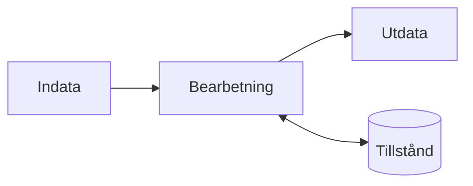

# Kapitel 1: Programmering som verktyg

> **I det här kapitlet lär du dig**
> - vad som skiljer tillämpad programmering från programmering i allmänhet
> - hur du använder abstraktion, dekomposition och algoritmer för att angripa ett problem
> - fyra modeller som återkommer i hela boken
> - vad ett program kan avgöra och vad det inte kan avgöra

Ett program är sällan målet i sig. Sjukhuset vill korta vårdköer, spelstudion vill att spelet ska kännas rätt, och roboten ska ta sig över golvet utan att krocka. Koden är verktyget som löser problemet. Den här kursen handlar om att använda programmering på verkliga områden, och om att förstå vad det får för följder.

## Vad betyder tillämpad programmering?

I ämnet tillämpad programmering väljer du ett **tillämpningsområde**, alltså det ämne eller den bransch där programmeringen ska göra nytta. Kunskapen om området är lika viktig som kunskapen om språket. Du kan skriva felfri Python och ändå bygga fel sak om du inte förstår vad användaren behöver.

| Område | Typiskt problem | Vad programmet gör |
|---|---|---|
| Cybersäkerhet | Hur märker vi att någon försöker ta sig in? | Analyserar loggar och varnar |
| Spel | Hur känns hoppet rätt på alla datorer? | Räknar rörelse utifrån verklig tid |
| Administration | Hur vet vi vem som har lånat vad? | Sparar, söker och uppdaterar poster |
| Robotik | Hur tar sig roboten runt ett hinder? | Läser sensorer och styr motorer |

Kursen består av fyra projekt, och de rör sig över flera av de här områdena. Du möter alltså samma grundtankar i olika kläder, vilket är en bra träning i att se vad som är gemensamt.

## Fyra sätt att tänka

När ett problem känns för stort hjälper det att bryta ner det på ett systematiskt sätt. Fyra tankeverktyg kommer du att använda hela tiden.

- **Dekomposition** betyder att dela upp problemet i mindre delar som går att lösa var för sig.
- **Mönsterigenkänning** betyder att se att ett delproblem liknar något du redan har löst.
- **Abstraktion** betyder att bortse från detaljer som inte spelar någon roll just nu. En karta över tunnelbanan visar inte hur stationerna ser ut, bara hur de hänger ihop.
- **Algoritm** är en exakt beskrivning, steg för steg, av hur ett problem ska lösas. Stegen ska vara så tydliga att en dator kan utföra dem utan att gissa.

## Fyra modeller som återkommer

En **modell** är en förenklad bild av hur något fungerar. Den stämmer aldrig helt, men den hjälper dig att tänka och att prata med andra.



**Indata, bearbetning och utdata.** Nästan alla program tar emot något, gör något med det och lämnar ett resultat. Om du kan peka ut de tre delarna har du förstått mycket av programmet.

**Tillstånd.** Tillståndet är det programmet minns mellan två händelser, till exempel saldot på ett konto. Många buggar uppstår för att tillståndet blev något annat än du trodde.

**Klient och server.** En klient, till exempel en webbläsare, ber om något. En server svarar. Modellen förklarar varför du aldrig kan lita på det som kommer från klienten, vilket är centralt i kapitel 3.

**Publicera och prenumerera.** Program skickar meddelanden till en namngiven kanal utan att veta vem som lyssnar. Det är grunden för robotsystemen i kapitel 9.

## Genomgånget exempel: misstänkta inloggningar

Tänk dig att en tjänst sparar en rad i en logg för varje inloggningsförsök. En **logg** är en fil där ett system antecknar vad som händer. Vi vill veta vilka konton som har många misslyckade försök. Materialet nedan är påhittat.

Med dekomposition blir uppgiften tre delar: läs en rad, räkna felen per konto, och välj ut konton över en gräns.

```python
LOGG = [
    "08:01 kontoA OK",
    "08:02 kontoB FEL",
    "08:02 kontoB FEL",
    "08:03 kontoC OK",
    "08:03 kontoB FEL",
    "08:04 kontoA FEL",
    "08:05 kontoB OK",
]

def rakna_fel(rader):
    """Räknar misslyckade försök per konto."""
    antal = {}
    for rad in rader:
        tid, konto, status = rad.split()
        if status == "FEL":
            antal[konto] = antal.get(konto, 0) + 1
    return antal

def misstankta(antal, grans=3):
    """Returnerar konton med minst grans misslyckade försök."""
    return [konto for konto, fel in antal.items() if fel >= grans]

antal = rakna_fel(LOGG)
print(antal)
print(misstankta(antal))
```

Körningen ger:

```text
{'kontoB': 3, 'kontoA': 1}
['kontoB']
```

Gå igenom vad som hände. Varje rad i `LOGG` delas upp i tre delar med `split`. Ordboken `antal` är programmets tillstånd. Den växer för varje `FEL`, och `antal.get(konto, 0)` ger noll första gången ett konto dyker upp. Funktionen `misstankta` är en separat del, så du kan byta gränsvärde utan att röra räknandet.

Lägg märke till abstraktionen: en hel människas inloggning har blivit tre textbitar. Vi bortser från allt annat, till exempel vilken dator försöket kom från.

## Möjligheter och begränsningar

Programmet gör på en sekund det som skulle ta dig timmar för hand, och det tröttnar aldrig. Men det kan bara svara på det frågan handlar om. Tre fel på `kontoB` kan vara en angripare, och det kan lika gärna vara någon som glömt sitt lösenord. Programmet vet inte vilket. Gränsen tre är dessutom ett val som en människa har gjort.

Det här är en viktig princip i hela kursen. Ett program behandlar de **data** det får, enligt de regler någon har skrivit. Är datan fel, eller reglerna dåligt valda, blir resultatet fel, hur snabbt det än räknas fram.

## Begrepp

- **Tillämpningsområde:** det område där programmeringen används och ska göra nytta.
- **Dekomposition:** att dela upp ett problem i mindre delar.
- **Abstraktion:** att bortse från detaljer som inte behövs för stunden.
- **Algoritm:** en exakt beskrivning, steg för steg, av hur ett problem löses.
- **Modell:** en förenklad bild av hur något fungerar.
- **Tillstånd:** det programmet minns mellan händelser.
- **Logg:** en fil där ett system antecknar vad som händer.

## Koppling till projektet

Kapitlet är grunden för alla fyra projekten. I [Cyberintro](../projekt/cyberintro/README.md) är loggar och begreppet tillstånd en bra början, och modellerna kommer tillbaka i [Önskeprojekt](../projekt/onskeprojekt/README.md) och [Robotik: Sköldpaddan](../projekt/skoldpaddan/README.md).

## Läs mer

- [Pythons officiella handledning](https://docs.python.org/3/tutorial/)

[Innehåll](../README.md) | [Nästa →](02-cybersakerhet-grunder.md)
