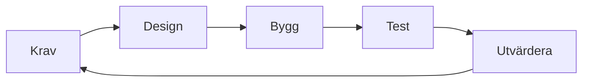

# Kapitel 4: Från idé till plan

> **I det här kapitlet lär du dig**
> - hur du gör en lös idé till ett avgränsat problem
> - hur du skriver krav och prioriterar dem
> - skillnaden mellan olika utvecklingsprocesser och hur delarna hänger ihop
> - hur du räknar på om planen får plats i den tid du har

"Jag ska bygga ett spel som Minecraft" är ett vanligt sätt att börja, och ett vanligt sätt att misslyckas. Att välja ett eget projekt är roligt, men friheten kräver att du själv gör jobbet en beställare annars skulle göra: bestämma vad som ska byggas och framför allt vad som inte ska byggas.

## Från idé till problem

En idé beskriver en lösning. Ett **problem** beskriver något som behöver bli bättre för någon. Börja med att formulera problemet, för det hjälper dig att välja rätt lösning.

En enkel mall räcker: *för vem*, *vad är problemet*, *hur vet vi att det är löst*.

| Fråga | Exempel |
|---|---|
| För vem? | Den som styrketränar själv |
| Vad är problemet? | Det är svårt att minnas vad man lyfte förra gången |
| Hur vet vi att det är löst? | Användaren ser sitt senaste pass på under tio sekunder |

Det sista är en mätbar **framgångsfaktor**. Den gör att du kan avgöra om du lyckades, i stället för att tycka något.

## Avgränsning och krav

**Avgränsning** betyder att du bestämmer vad som inte ingår. Skriv ner det. Det känns onödigt, men det skyddar dig när nya idéer kommer mitt i arbetet.

Ett **krav** beskriver något som produkten ska göra eller vara. Ett bra krav går att testa. "Appen ska vara snabb" går inte att testa, men "listan ska visas inom en sekund" går att testa.

Ett **MVP**, minsta användbara produkt, är den minsta version som faktiskt löser problemet. Bygg den först. Det är då du lär dig något om idén håller.

Prioriteringen görs ofta med **MoSCoW**, som delar in kraven i Måste, Bör, Kan och Inte nu (på engelska *must, should, could, won't*).

## Utvecklingsprocesser

En **utvecklingsprocess** är det sätt ett arbete är organiserat på. Tre grundtyper är bra att känna till.

| Process | Så fungerar det | Passar när | Nackdel |
|---|---|---|---|
| **Vattenfall** | En fas i taget: krav, design, bygg, test | Kraven är kända och stabila | Fel upptäcks sent |
| **Iterativ** | Hela cykeln upprepas i små varv | Du behöver lära dig under vägen | Kräver disciplin att avsluta |
| **Agil, t.ex. Scrum** | Korta tidsrutor och ofta återkoppling | Kraven förändras | Fungerar sämre utan engagemang från alla |

**Scrum** är ett vanligt agilt ramverk där arbetet delas in i **sprintar**, korta perioder med ett tydligt mål. Listan över allt som ska göras kallas **backlogg**.

Pilen tillbaka är det viktiga i bilden. Delarna i en process hänger ihop och påverkar varandra:

- Ändras ett krav påverkar det design, kod, tester och tidsplan.
- Ett dåligt skrivet krav går inte att testa, och då vet du inte när du är klar.
- En test som visar att användaren inte förstår gränssnittet skickar dig tillbaka till designen.
- En tidsplan som spricker tvingar dig att ändra prioriteringen, alltså kraven.

När du resonerar om din process ska du kunna visa just sådana samband, med exempel från ditt eget arbete.

## Genomräknat exempel: får planen plats?

Du har valt en app för träningsdagbok och har 30 timmar att arbeta. Du skriver en backlogg och uppskattar varje punkt.

| Punkt | Prioritet | Timmar |
|---|---|---|
| Lägga in ett träningspass | Måste | 4 |
| Visa tidigare pass | Måste | 3 |
| Spara data mellan körningar | Måste | 2 |
| Enkelt gränssnitt | Måste | 5 |
| Visa framsteg som diagram | Bör | 3 |
| Mallar för pass | Bör | 5 |
| Dela pass med kompisar | Kan | 6 |

Räkna samman: Måste blir 4 + 3 + 2 + 5 = 14 timmar, Bör blir 3 + 5 = 8 timmar och Kan blir 6 timmar. Totalt 28 timmar. Det ser ut att gå.

Men uppskattningar brukar vara för optimistiska, och du behöver tid för test, felsökning och dokumentation. Lägg därför undan en **tidsbuffert**, en reserv för det oväntade, på 20 procent: 30 · 0,8 = 24 timmar kvar att planera med.

Måste och Bör blir 14 + 8 = 22 timmar, vilket ryms. Kan-punkten på 6 timmar får inte plats: 22 + 6 = 28 timmar är mer än 24. Du strukturerar alltså arbetet så att delning med kompisar blir något du gör om tiden räcker, och du vet från början vad du tar bort först.

## Följ upp under arbetet

En plan är ett antagande. Jämför regelbundet vad du trodde med vad som hände. Tar uppgifterna dubbelt så lång tid? Då är resten av planen också fel, och det är bättre att se det tidigt.

Skriv en **projektlogg** med några rader per arbetspass: vad du gjorde, vad som gick fel och vad du beslutade. Den är det bästa underlaget när du senare ska reflektera över dina val, och du kommer inte att minnas det annars.

## Begrepp

- **Problem:** något som behöver bli bättre för någon, till skillnad från en lösning.
- **Framgångsfaktor:** ett mätbart sätt att avgöra om målet är nått.
- **Avgränsning:** ett beslut om vad som inte ingår.
- **Krav:** något som produkten ska göra eller vara, formulerat så att det går att testa.
- **MVP:** den minsta version som faktiskt löser problemet.
- **MoSCoW:** ett sätt att prioritera krav i Måste, Bör, Kan och Inte nu.
- **Backlogg:** en prioriterad lista över det som ska göras.
- **Sprint:** en kort, tidsbegränsad arbetsperiod i Scrum.
- **Tidsbuffert:** tid som reserveras för det oväntade.

## Testa dig själv

1. Varför är "bygga en app" ingen bra problemformulering?
2. Skriv om kravet "spelet ska vara kul" så att det går att testa, eller förklara varför det är svårt.
3. När passar vattenfall bättre än en agil process?
4. Ge ett exempel på hur en ändring i kraven påverkar någon annan del i processen.
5. Varför bygger du MVP:n först?
6. Vad händer med planen om du inte reserverar tid för det oväntade?

## Koppling till projektet

Det här kapitlet används först i [Önskeprojekt](../projekt/onskeprojekt/README.md), där du själv avgränsar vad du ska bygga. Planeringssätten kommer du att använda igen i [Förstudie + projekt + marknad](../projekt/forstudie-projekt-marknad/README.md).

## Läs mer

- [Agila manifestet på svenska](https://agilemanifesto.org/iso/sv/manifesto.html)
- [The Scrum Guide](https://scrumguides.org/)

[← Föregående](03-saker-kod.md) | [Innehåll](../README.md) | [Nästa →](05-problemlosning-och-test.md)
