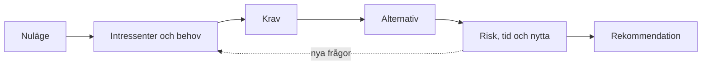

# Kapitel 7: Förstudien

> **I det här kapitlet lär du dig**
> - vad en förstudie är och varför den görs innan projektet startar
> - hur du tar reda på vem som berörs och vad de behöver
> - hur du skriver krav och jämför lösningar
> - hur du räknar på tid, nytta och risk

Det dyraste felet i ett projekt är att bygga fel sak. En **förstudie** är en utredning som görs innan projektet startar, för att ta reda på om det är värt att göra och i så fall hur. Den kostar lite tid och kan spara mycket.

## Vad en förstudie svarar på

En förstudie svarar på några grundfrågor.

| Fråga | Innehåll |
|---|---|
| Vad är problemet? | Nuläge, vad som inte fungerar, vem som drabbas |
| Vad är målet? | Önskat läge, mätbara mål |
| Vem berörs? | Intressenter och deras behov |
| Vad krävs? | Krav på lösningen |
| Vilka lösningar finns? | Alternativ, inklusive att köpa färdigt eller inte göra något |
| Går det? | Teknik, tid, kostnad, juridik |
| Vad kan gå fel? | Risker och hur de hanteras |
| Vad rekommenderas? | Ett motiverat förslag |



Den streckade pilen är viktig: när du räknar på ett alternativ upptäcker du ofta att du behöver fråga mer.

## Intressenter och behov

En **intressent** är någon som berörs av projektet: användare, beställare, och de som ska drifta eller underhålla systemet. Även de som påverkas utan att vara användare räknas.

Ta reda på behoven genom att fråga och observera:

- **Intervjuer** ger djup. Ställ öppna frågor och be personen berätta om hur de gör i dag.
- **Enkäter** ger bredd, men bara på det du tänkt på att fråga om.
- **Observation** visar hur det faktiskt går till. Människor beskriver ofta sitt arbete på ett annat sätt än de utför det.

Ett vanligt fel är att fråga "Vill du ha en app?". Svaret säger nästan ingenting. Fråga i stället om det senaste tillfället något krånglade.

Var också försiktig med personuppgifter. Samla bara det du behöver, berätta varför och ta bort det när det inte längre behövs.

## Krav

I [kapitel 4](04-fran-ide-till-plan.md) såg du att ett krav ska gå att testa. Nu delar vi upp kraven i två sorter.

- Ett **funktionellt krav** beskriver vad systemet ska göra: "Användaren ska kunna söka på artikelnummer."
- Ett **icke-funktionellt krav** beskriver hur bra det ska vara: "Sökningen ska ge svar inom två sekunder." Säkerhet, tillgänglighet och prestanda hör hit.

Skriv varje krav så att du senare kan pricka av om det är uppfyllt. Kravlistan blir sedan grunden för både arbetet och testningen, och där ser du sambandet mellan delarna i processen.

## Jämför alternativ

Rekommendationen blir trovärdig först när du har jämfört den med något. Tänk särskilt på det alternativ som är lätt att glömma: att inte bygga något. Finns redan en tjänst som löser problemet billigare?

| Kriterium (vikt) | Bygg eget | Färdig tjänst | Gör inget |
|---|---|---|---|
| Löser problemet (3) | 3 | 2 | 0 |
| Kostnad (2) | 1 | 2 | 3 |
| Går att underhålla (2) | 1 | 3 | 3 |
| **Viktad summa** | 3·3 + 2·1 + 2·1 = **13** | 3·2 + 2·2 + 2·3 = **16** | 3·0 + 2·3 + 2·3 = **12** |

Här vinner den färdiga tjänsten. Tabellen är påhittad, men den visar hur en beslutsmatris gör dina prioriteringar synliga. Vikterna är också ett val, och andra vikter kan ge ett annat svar. Skriv därför alltid varför du valt dem.

## Genomräknat exempel: tid och nytta

**Tidsuppskattning.** En enkel metod är **trepunktsuppskattning**. Du gör en optimistisk (O), en trolig (T) och en pessimistisk (P) bedömning och väger ihop dem:

Uppskattning = (O + 4 · T + P) / 6

Om en uppgift optimistiskt tar 4 timmar, troligen 6 timmar och pessimistiskt 14 timmar, blir det (4 + 4 · 6 + 14) / 6 = 42 / 6 = 7 timmar. Svaret blir större än den troliga tiden, eftersom det som kan gå fel ofta drar i väg mer än det som kan gå bra.

**Nytta.** Tänk dig ett påhittat företag där åtta personer lägger tolv minuter varje arbetsdag på en uppgift som ett program kan göra. Antag 220 arbetsdagar per år.

12 · 8 · 220 = 21 120 minuter per år, alltså 21 120 / 60 = 352 timmar per år.

Om programmet tar 120 timmar att bygga, blir **återbetalningstiden** 120 / 352 ≈ 0,34 år, ungefär fyra månader. Återbetalningstiden är den tid det tar innan nyttan har betalat kostnaden.

Räkningen är förenklad. Du har inte räknat med underhåll, och det är inte säkert att all sparad tid används till något nyttigt. Att säga det själv gör din förstudie trovärdig.

```python
minuter = 12 * 8 * 220
timmar = minuter / 60
print(minuter, timmar, round(120 / timmar, 2))
print((4 + 4 * 6 + 14) / 6)
```

## Risker

Riskmatrisen från [kapitel 2](02-cybersakerhet-grunder.md) fungerar också här. Bedöm sannolikhet och konsekvens, och skriv vad du gör för att minska risken. Vanliga risker är att en nyckelperson försvinner, att tekniken inte fungerar som du trodde, och att kraven förändras.

## Så skriver du rapporten

Skriv kort och konkret. En rapport läses av någon som har ont om tid och vill veta vad du rekommenderar. Börja därför med en sammanfattning. Skilj på det du vet och det du antar, och skriv var uppgifterna kommer ifrån.

## Begrepp

- **Förstudie:** en utredning som görs innan ett projekt startar.
- **Intressent:** någon som berörs av ett projekt.
- **Funktionellt krav:** något systemet ska göra.
- **Icke-funktionellt krav:** hur bra systemet ska vara, till exempel snabbhet eller säkerhet.
- **Beslutsmatris:** en tabell med viktade kriterier för att jämföra alternativ.
- **Trepunktsuppskattning:** en tidsuppskattning som väger ihop optimistisk, trolig och pessimistisk tid.
- **Återbetalningstid:** den tid det tar innan nyttan har betalat kostnaden.

## Koppling till projektet

Det här kapitlet används till den första delen av [Förstudie + projekt + marknad](../projekt/forstudie-projekt-marknad/README.md). Exakt vad din rapport ska innehålla bestämmer läraren, men de här verktygen kan du använda oavsett upplägg.

## Läs mer

- [IMY: det här gäller enligt GDPR](https://www.imy.se/verksamhet/dataskydd/det-har-galler-enligt-gdpr/)
- [Verksamt: starta och driva företag](https://www.verksamt.se/)

[← Föregående](06-tillampningar.md) | [Innehåll](../README.md) | [Nästa →](08-projekt-och-marknad.md)
