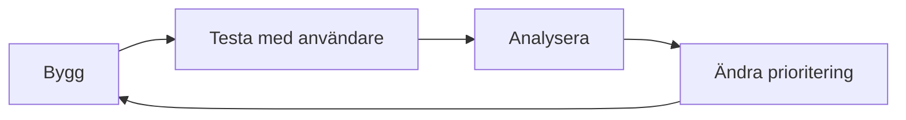

# Kapitel 8: Projektet, användarna och marknaden

> **I det här kapitlet lär du dig**
> - hur du arbetar i projekt så att arbetet hänger ihop med förstudien
> - hur du testar med riktiga användare
> - hur du beskriver målgrupp och värdeerbjudande
> - hur du räknar på om något kan bära sina kostnader och hur du presenterar det

När förstudien är klar börjar genomförandet. Det är också nu det visar sig att verkligheten inte följer rapporten. Det här kapitlet handlar om att genomföra projektet, kontrollera att det fungerar för dem det är till för, och berätta om det så att andra förstår värdet.

## Från förstudie till genomförande

Förstudiens krav blir din backlogg, och dess risker blir saker att bevaka. Kopplingen är viktig: om du inte använder förstudien i projektet var den bortkastad.

Tre saker ger ett projekt struktur när ni är flera.

- **Tydliga roller.** Vem bestämmer vad? Vem kontaktar beställaren?
- **Regelbunden avstämning.** Korta möten där var och en säger vad som är gjort, vad som ska göras och vad som hindrar.
- **Gemensam kodbas.** Använd Git med **grenar**, separata utvecklingsspår som slås ihop när en funktion är färdig.

Hur skulle du ändra planen om en viktig funktion visar sig vara mycket svårare? Bestäm tidigt vem som fattar sådana beslut. Ändringar är inget misslyckande, men de ska göras medvetet och skrivas ner. Berätta för den som beställt arbetet.

## Att testa med användare

Du kan inte testa din egen produkt på riktigt, eftersom du redan vet hur den fungerar. Ett **användartest** går till så här:

1. Skriv några uppgifter, till exempel "Boka en tid på fredag".
2. Be testpersonen tänka högt medan hen försöker.
3. **Hjälp inte till**, även om det är svårt att se på. Det är just där du lär dig något.
4. Anteckna vad som krånglar, och fråga efteråt.

Berätta för testpersonen att det är produkten som testas, inte personen. Spara inga personuppgifter i onödan.

Du kan räkna på resultatet. Om fyra av fem testpersoner klarar uppgiften är andelen 4/5 = 80 procent. Med fem personer säger siffran inte särskilt mycket statistiskt. Däremot hittar du de stora problemen, och det är målet.



## Tillgänglighet och kvalitet

Testa också att produkten fungerar med tangentbord, med stor text och med tillräcklig kontrast. **Tillgänglighet** betyder att människor med olika förutsättningar kan använda produkten. Riktlinjerna WCAG är den vanligaste utgångspunkten.

## Marknad: vem är det till för?

Här betyder **marknad** de människor eller organisationer som har problemet och kan tänka sig att använda, köpa eller stödja lösningen. Vad marknadsdelen i ditt projekt ska innehålla bestämmer läraren. Följande begrepp är ändå användbara.

- **Målgrupp** är de du riktar dig till. "Alla" är ingen målgrupp, för då blir budskapet för allmänt. Beskriv gruppen så konkret du kan.
- Ett **värdeerbjudande** är ett kort svar på varför någon ska välja det här. Ett sätt att skriva det är: *För [vem] som [har problemet] är [produkten] en [typ av lösning] som [nytta]*.
- **Konkurrenter** är andra sätt att lösa samma problem. Ofta är det största alternativet ett papper, ett kalkylblad eller att inte göra något alls.

Marknadsföringen ska vara ärlig. Lova inte det produkten inte klarar, och samla inte in personuppgifter utan tydligt syfte.

## Genomräknat exempel: när går det runt?

Tänk dig en påhittad tjänst där driften kostar 3 000 kronor per år. Användarna betalar 20 kronor i månaden och varje användare kostar 2 kronor i månaden i exempelvis betalningsavgifter.

Bidraget per användare är 20 − 2 = 18 kronor i månaden, alltså 18 · 12 = 216 kronor per år.

**Nollpunkten** är antalet användare som krävs för att täcka kostnaderna: 3 000 / 216 ≈ 13,9, alltså 14 användare.

Hur många besökare krävs? Om 5 procent av besökarna blir betalande kunder behövs 14 / 0,05 = 280 besökare. Andelen på 5 procent är ett antagande som du inte vet stämmer. Testa med några besökare innan du litar på den.

```python
import math

bidrag_ar = (20 - 2) * 12
nollpunkt = math.ceil(3000 / bidrag_ar)
print(bidrag_ar, nollpunkt, nollpunkt / 0.05)
```

Alla projekt ska inte tjäna pengar. Ett verktyg för en förening kan vara värdefullt ändå. Men frågan om vem som ska stå för driften och underhållet efter att projektet är slut behöver alltid besvaras.

## Att presentera

En **pitch** är en kort presentation av en idé eller produkt. En användbar ordning:

1. **Problemet:** konkret och med en verklig situation.
2. **Lösningen:** visa hellre än beskriv.
3. **Beviset:** vad du testade och vad du lärde dig.
4. **Läget:** vad som fungerar nu och vad som saknas.
5. **Nästa steg:** vad du vill att åhörarna ska göra.

Anpassa språket. Någon utan teknisk bakgrund behöver veta vad produkten gör för dem, inte vilket ramverk du använde. Var förberedd på frågor om kostnad, säkerhet och underhåll. Testa din demonstration i förväg, och ha en reservplan om nätverket krånglar.

## Begrepp

- **Gren:** ett separat utvecklingsspår i Git.
- **Användartest:** att låta riktiga användare försöka lösa uppgifter med produkten.
- **Tillgänglighet:** att personer med olika förutsättningar kan använda produkten.
- **Målgrupp:** de människor eller organisationer lösningen riktar sig till.
- **Värdeerbjudande:** ett kort svar på varför någon ska välja lösningen.
- **Nollpunkt:** antalet användare eller försäljningar som krävs för att täcka kostnaderna.
- **Pitch:** en kort presentation av en idé eller produkt.

## Koppling till projektet

Kapitlet täcker de delar som kommer efter förstudien i [Förstudie + projekt + marknad](../projekt/forstudie-projekt-marknad/README.md). I lektionsplanen avslutas projektet med en redovisning, så presentationsdelen kommer till användning där.

## Läs mer

- [WCAG, riktlinjerna för webbtillgänglighet](https://www.w3.org/WAI/standards-guidelines/wcag/)
- [Pro Git, om grenar](https://git-scm.com/book/en/v2/Git-Branching-Branches-in-a-Nutshell)
- [Verksamt: starta och driva företag](https://www.verksamt.se/)

[← Föregående](07-forstudien.md) | [Innehåll](../README.md) | [Nästa →](09-robotik-ros2.md)
