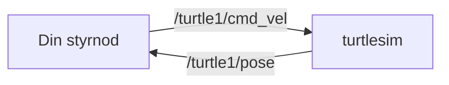
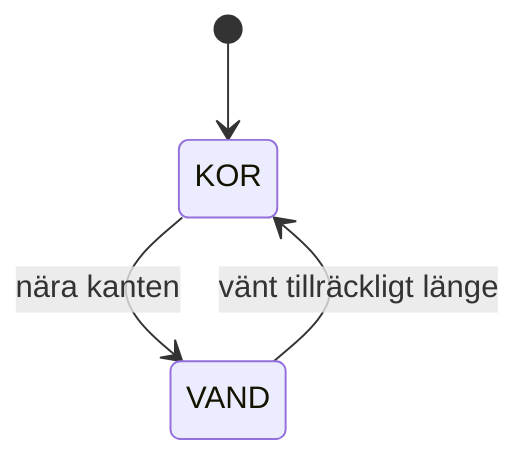

# Kapitel 9: Robotik med ROS2 och turtlesim

> **I det här kapitlet lär du dig**
> - hur en robot är uppbyggd som ett program: känna, tänka, agera
> - vad noder, topics, meddelanden och services är i ROS2
> - hur du räknar på rörelse med fart och vinkelfart
> - hur en tillståndsmaskin ger en robot ett beteende

En robot är programmering som möter verkligheten. Sensorerna ger osäkra värden, motorerna reagerar inte exakt, och golvet är inte plant. Därför börjar nästan all robotprogrammering i en simulator, där ett fel kostar en omstart i stället för en trasig maskin. I det här kapitlet använder vi turtlesim, en enkel simulator där du styr en sköldpadda på skärmen.

## Känna, tänka, agera

De flesta robotar arbetar i en cykel som kallas **känna, tänka, agera**:

1. **Känna:** läs sensorer, till exempel position eller avstånd.
2. **Tänka:** bestäm vad som ska göras utifrån det du vet.
3. **Agera:** styr motorerna.

Cykeln upprepas hela tiden, och det påminner om PLC:ns scan-cykel i [kapitel 6](06-tillampningar.md).

## ROS2 i korthet

**ROS2** står för Robot Operating System 2. Trots namnet är det inget operativsystem utan ett **ramverk**, en samling verktyg och bibliotek som du bygger program ovanpå. Tanken är att ett robotsystem delas upp i många små program som samarbetar.

| Begrepp | Betyder |
|---|---|
| **Nod** | Ett program med en uppgift, till exempel att läsa en sensor |
| **Topic** | En namngiven kanal där meddelanden skickas |
| **Meddelande** | Data med en bestämd struktur |
| **Publisher** | En nod som skickar till ett topic |
| **Subscriber** | En nod som lyssnar på ett topic |
| **Service** | Fråga och svar för engångsanrop, till exempel "skapa en ny sköldpadda" |

Det här är modellen publicera och prenumerera från [kapitel 1](01-programmering-som-verktyg.md). Noder behöver inte veta vem som lyssnar, så en nod går att byta ut utan att de andra ändras.



I turtlesim finns två topics som är särskilt viktiga. På `/turtle1/cmd_vel` skickas styrkommandon av typen `Twist`, där `linear.x` är farten framåt och `angular.z` är vridningen. På `/turtle1/pose` publicerar simulatorn var sköldpaddan befinner sig, med `x`, `y` och riktningen `theta`.

## Genomräknat exempel: att rita en cirkel

Vinkelfart mäts i radianer per sekund. Ett varv är 2π radianer. Med farten v och vinkelfarten ω blir radien r = v / ω.

Säg att sköldpaddan har v = 2,0 enheter/s och ω = 1,0 rad/s.

- Radie: r = 2,0 / 1,0 = 2,0 enheter.
- Cirkelns omkrets: 2 · π · 2,0 ≈ 12,57 enheter.
- Tid för ett varv: 2π / 1,0 ≈ 6,28 sekunder.

Kontrollera: fart gånger tid är 2,0 · 6,28 ≈ 12,57 enheter, samma som omkretsen.

En kvarts vridning, 90 grader, är π/2 radianer. Med ω = 1,0 rad/s tar den π/2 ≈ 1,57 sekunder.

Så här kan en publisher se ut i Python. Koden kräver en ROS2-installation för att köras.

```python
import rclpy
from rclpy.node import Node
from geometry_msgs.msg import Twist

class Cirkelkorare(Node):
    def __init__(self):
        super().__init__('cirkelkorare')
        self.pub = self.create_publisher(Twist, '/turtle1/cmd_vel', 10)
        self.create_timer(0.1, self.skicka)

    def skicka(self):
        kommando = Twist()
        kommando.linear.x = 2.0
        kommando.angular.z = 1.0
        self.pub.publish(kommando)

def main():
    rclpy.init()
    rclpy.spin(Cirkelkorare())
    rclpy.shutdown()
```

`create_timer` gör att `skicka` anropas tio gånger per sekund. Det är ett vanligt mönster: noden gör ingenting själv, utan **händelser** får den att arbeta. En **callback** är en funktion som systemet anropar när något händer.

## Tillståndsmaskiner

En robot som ska göra olika saker vid olika tillfällen behöver ett **tillstånd**. En **tillståndsmaskin** är en modell där programmet alltid befinner sig i exakt ett tillstånd, och där tydliga villkor bestämmer när det byter.



Om du håller logiken skild från ROS2 kan du testa den utan robot och utan simulator:

```python
KOR = "kor"
VAND = "vand"

def nara_kant(x, y, marginal=1.0, storlek=11.0):
    return (x < marginal or x > storlek - marginal
            or y < marginal or y > storlek - marginal)

def nasta_tillstand(tillstand, nara, tid_i_tillstand, vandtid=1.5):
    if tillstand == KOR and nara:
        return VAND
    if tillstand == VAND and tid_i_tillstand >= vandtid:
        return KOR
    return tillstand

assert nasta_tillstand(KOR, False, 0.0) == KOR
assert nasta_tillstand(KOR, True, 0.0) == VAND
assert nasta_tillstand(VAND, True, 0.5) == VAND
assert nasta_tillstand(VAND, True, 1.5) == KOR
assert nara_kant(0.5, 5.0) is True
assert nara_kant(5.5, 5.5) is False
print("Beteendet stämmer")
```

Att separera logiken från robotens delar är en användbar arbetsmetod. Du kan köra testerna på vilken dator som helst, och buggarna hittas innan något rör sig.

## Genomräknat exempel: täckning

Hur vet du om en robot har täckt hela ytan? Dela in ytan i ett rutnät och markera rutorna den har varit i. Turtlesims arena är ungefär 11 × 11 enheter. Med ett rutnät på 8 × 8 rutor blir varje ruta 11 / 8 = 1,375 enheter bred.

Positionen x = 5,5 hamnar i kolumn `int(5.5 / 11 * 8)` = `int(4.0)` = 4, om du börjar räkna från noll. Med x = 9,9 hamnar den i kolumn 7.

```python
RUTOR = 8
ARENA = 11.0

def ruta(x, y):
    kolumn = min(RUTOR - 1, max(0, int(x / ARENA * RUTOR)))
    rad = min(RUTOR - 1, max(0, int(y / ARENA * RUTOR)))
    return rad, kolumn

besokta = {ruta(5.5, 5.5), ruta(9.9, 5.5), ruta(5.5, 5.6)}
print(len(besokta), "av", RUTOR * RUTOR, "rutor")
```

Programmet skriver ut `2 av 64 rutor`, eftersom två av positionerna ligger i samma ruta. Mätningen gör att du kan jämföra strategier med siffror i stället för att tycka: täcker slumpvis körning mer eller mindre än en strategi som kör rader fram och tillbaka under samma tid?

## Simulering och verklighet

En simulering är en modell, och den har gränser. I turtlesim är positionen exakt, men en riktig sensor ger värden med fel. En riktig bil slirar. Riktiga motorer behöver tid på sig att reagera. Därför måste en lösning som fungerar i simulatorn alltid provas på riktigt innan du kan lita på den.

## Begrepp

- **Känna, tänka, agera:** robotens grundcykel.
- **ROS2:** ett ramverk för robotprogramvara.
- **Nod:** ett program i ett ROS2-system.
- **Topic:** en namngiven kanal för meddelanden.
- **Publisher och subscriber:** en nod som skickar respektive lyssnar.
- **Service:** en fråga med ett svar.
- **Callback:** en funktion som systemet anropar när något händer.
- **Tillståndsmaskin:** en modell där programmet är i ett tillstånd i taget.
- **Simulator:** ett program som efterliknar något verkligt.

## Testa dig själv

1. Vad är skillnaden mellan ett topic och en service?
2. Varför är det bra att noder inte behöver veta vilka som lyssnar?
3. Vilken radie får en cirkel med v = 3 och ω = 1,5?
4. Hur lång tid tar en halv vridning med ω = 1,0 rad/s?
5. Vilka tillstånd finns i exemplet, och vad får roboten att byta?
6. Varför är det bra att hålla logiken skild från ROS2-koden?
7. Vad är det som en simulator inte kan visa?

## Koppling till projektet

Det här kapitlet förbereder [Robotik: Sköldpaddan](../projekt/skoldpaddan/README.md). Labbarna i [ROS2-repot](https://github.com/abbjetmus/ROS2) går igenom begreppen praktiskt, från att starta turtlesim till att skriva egna noder.

## Läs mer

- [ROS2-dokumentationen](https://docs.ros.org/en/jazzy/)
- [Turtlesim i ROS2-dokumentationen](https://docs.ros.org/en/jazzy/Tutorials/Beginner-CLI-Tools/Introducing-Turtlesim/Introducing-Turtlesim.html)
- [ROS2: topics](https://docs.ros.org/en/jazzy/Concepts/Basic/About-Topics.html)

[← Föregående](08-projekt-och-marknad.md) | [Innehåll](../README.md) | [Nästa →](10-konsekvenser-och-reflektion.md)
